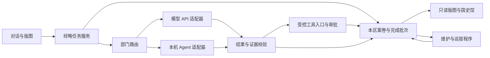

# 三省六部·经略｜可行性方案

**文档 v0.1 · 2026-11-06 · 立项评审稿**

经略承接官制的角色、工序、授权和证据规则。官制与经略分别管理版本，案卷记录当时采用的规则与程序版本。

## 1. 可行性结论

**可以进入本地技术验证。** 本机已有阶段推进、审批证据、文件占用和周期任务检查，可作为经略的规则与实现参考。新产品的主要开发工作是独立对话运行、供应商与本机执行者适配、真正的工具权限控制，以及面向业务的任务与版图数据。

本轮实查了旧案卷，也用独立的 SQLite 夹具验证了归档事务。下一道门是用一个真实模型 API 和一个真实本机 Agent 分别走通，再验证两端接力、权限越界和写入中断。软件级验收仍待实施。 本轮核验结果

## 2. 可复用能力与开发缺口

| 能力 | 已有依据 | 经略需要补齐 |
|---|---|---|
| 阶段与证据 | 现有工作流持有运行编号、阶段、结果与证据，放行考虑治理和发布后抽验 | 从对话创建、关联和恢复案卷。调度模型或本机 Agent，分别记尝试、验收批次和真实执行身份。 工作流 |
| 授权与复核 | 现有治理代码核对真实授权、范围、期限及执行身份 | 在工具实际执行前再次约束路径、动作和版本。现有阶段登记门禁可复用其规则，执行权限需单独验证。 授权校验 |
| 占用与重开 | 现有占用可检查重叠资源，工作流重开保留原编号和阶段历史 | 适配独立版的同任务多次执行。持久记录完成批次，处理未知结果和并发写入。 占用 · 重开 |
| 旧任务与成果 | 现有工作流可只读查询，交付物和历史仍在原工作区 | 增加业务归属、前置关系、验收时间和成果定位。旧资料缺证据时进待核。 版图需求 |
| 周报与御史巡按 | 周报程序已判期、认领和核完成凭据。周检已采样并输出治理结构检查 | 经略调用同一套程序入口原则，增加台账和版图归属对照。按授权输出候选，提交用户决定。 周报检查 · 现有周检 |

## 3. 建议架构

首轮以 **Windows 本机、单用户、一个授权工作区** 为试点。建议用 Python 实现编排和程序命令，配本地界面。启动、补跑和诊断使用独立入口。多工作区地图按授权聚合数据，首版前置关系限于同一工作区。首个 API、CLI 版本、安装形式和后续平台范围由接入验证决定。

### 3.1 接入、路由与执行

- 每个适配器报告发现、登录、能力和可执行状态。最小契约接收任务号、部门、阶段、获准资料和输出约定，返回实际执行者、结果、证据、建议动作和失败原因。第一轮选一个可实测 API 与一个有官方非交互入口的 CLI，后续扩展适配器。
- 程序先筛选能力、授权、配额和可用性，再按本次指定、部门主用、已批准的备用、全局默认派发。手工指定者遇阻时由用户决定换端。单个可用执行者可以兼任普通角色，独立复核按真实身份另行放行。
- 订阅能力以实际账号和官方调用通道为准。Codex 的官方资料确认可用 ChatGPT 登录，非交互命令可复用 CLI 登录，可作为首轮候选。发现安装、登录成功和业务任务验收应分别记录。 [Codex 认证](https://learn.chatgpt.com/docs/auth) · [非交互模式](https://learn.chatgpt.com/docs/non-interactive-mode)
- API 和本机 Agent 的结果先经过程序验证。外部 Agent 如果能自行调用工具，须在实测有效的隔离环境内运行。首轮可限制为只读建议或在隔离目录生成补丁，经略按明确授权校验并落盘。跨工作区或供应商交接时仅发送获准的任务资料。
- 高风险动作由程序核验有效批准。写入要绑定操作编号、资源范围和目标版本。结果未知时先对照原件、版本、占用和已有凭据，再决定重试或人工接手。用真实恶意路径、链接逃逸、批准撤销和响应丢失夹具验收。

### 3.2 案卷、版图与归档

| 数据 | 设计与边界 |
|---|---|
| 任务与尝试 | 每个工作区用本地 SQLite 保存经略任务、真实执行尝试、规则版本、审批证据引用与状态。改派或重试沿用稳定任务号，尝试单独编号。 |
| 业务层级 | 本稿采用待验证的展示方案。行省是业务类别，府与州同级，指客户、项目或持续主题，县是可单独验收的办理节点。工作区决定资料归属和权限。 |
| 前置与放行 | 同工作区验证边的存在、环路和完成批次。旧验收失效后重新判定未开工任务，在办后继待人工核对。验收事件记录实际放行时间和证据。 |
| 熟地与县志 | 按实际放行时间起算默认七天，配置可调整。维护命令以任务号和完成批次为唯一键，在本区一个短事务里写县志和归档标记。重开保留历史。现有文件归档仍走单独的迁移流程。 [SQLite 事务文档](https://www.sqlite.org/lang_transaction.html) · 原件归档入口 |
| 只读视图 | 王朝版图和国史馆查询可见状态与摘要。旧案读 `status` 或运行文件，现有 `dispatch()` 有周报检查副作用。县志打开就地证据，正式国史继续走翰林提名、御史核档和用户朱批。 现有派发 · 国史门禁 |
| 跳转与保存 | 记录稳定成果引用、实际路径和历史地址。默认保存范围由工作区确定，用户配置路径时校验权限。改名与归档保留任务链接，实际文件移动后经确认再更新当前定位。 |

旧数据先只读展示。经用户确认来源、完成证据和实际时间后，才纳入独立版写入流程，并指定唯一状态源。案卷正文和交付物留在所属工作区。应用启动或维护命令检查欠归档及周巡按，手动入口与周期入口走同样的判期和去重规则。无合格执行者进行语义复核时，先保留结构检查与待核项。

## 4. 实际核验与局限

| 本轮动作 | 实际结果 | 适用范围 |
|---|---|---|
| 只读检查聊天区现有工作流 | 5 份都有编号与开工时间，5 份均缺顶层完成时间、依赖和府县字段。核对前后文件集合与散列一致 | 支持只读接入试点。其他工作区及历史聊天覆盖另行验证。 |
| 隔离 SQLite 数据库 | 截止前保持原状。两次写入之间故障后一起回滚。两连接竞争只写一条县志。重试、重开与新完成批次均通过 | 验证事务和唯一约束设计。正式产品、文件写入网关、用户界面和真实供应商均待验收。 |

## 5. 分阶段实施与放行

| 阶段 | 交付 | 放行条件 |
|---|---|---|
| A · 技术验证 | 本机最小运行入口、隔离任务库、一个 API 适配和一个本机 CLI 适配 | API 单端、CLI 单端、同案卷混合接力各跑通最小样本。实测外部 Agent 访问边界。仅能校验补丁时，把能力收窄到已验证的隔离范围。 |
| B · 首版闭环 | 对话交办、执行者设置、治理与验收、版图、县志、周巡按与维护入口 | 以一省一府州的 A→B 跑通前置、审批、验收、七天归档、重启去重和重开。在本阶段的同一程序版本重跑需求说明书的隔离、真实接入和安全用例。 |
| C · 本机试用 | 安装或启动说明、操作手册、版本包、导出与恢复说明 | 干净 Windows 环境按说明启动并配置一个执行者，能独立办理普通任务。恢复原案卷、查证据并对照实际版本。 |
| D · 后续扩展 | 更多适配器、任职小样推荐、旧案批量候选和更大视图 | 依实际需求选做。每个新增适配器重新核账号权限、隔离、证据与用量。 |

### 决策风险与投入

- **供应商与客户端变化。** 先实测目标账号、调用能力、稳定结果格式和额度。出现登录或授权差异时保留待连接原因。测试预算由所选服务和实际用量确定。
- **真实写入的边界。** 主程序对范围、版本、撤回和重复动作负最终判断。出现无法证明的访问或副作用时，相关能力保持受限并列阻断。
- **旧案的归属和时间。** 避免用文件更新时间替代验收。在一个工作区先做只读接入，用样本核来源、可回查性和误归。
- **主要投入。** 先投入编排与适配、权限用例、最小案卷和验收，再做地图与巡按。维护一套可回放的合成用例，逐步增加真实验收。费用记录区分 API 用量、客户端已有订阅和本地维护。用实际验证结果估算排期和运行成本。
- **回退与权属。** 独立版状态就地备份，迁移前导出并记录规则、程序和数据版本。先用可丢弃测试区，恢复验证通过后再接真实工作区。研发过程中登记自研内容、第三方依赖及许可，保留版本、开发记录和使用说明供后续软著材料准备。

验收编号与通过条件见[需求说明书](./02-需求说明书.md)。页面、交互和版图口径见[产品设计](./01-产品设计.md)。
